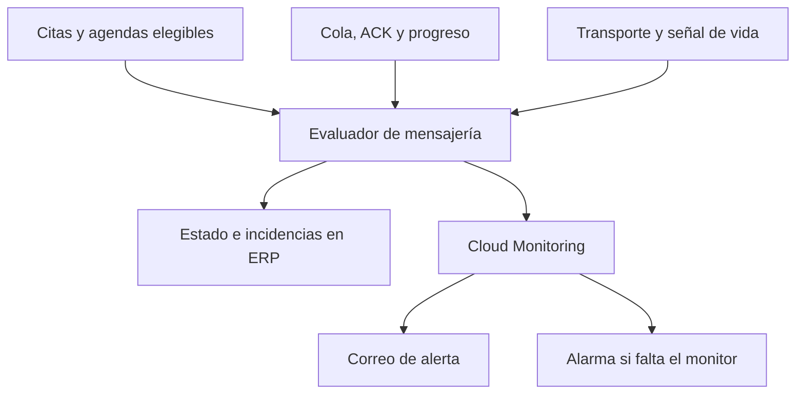

# DEMAC — Diseño de detección temprana de fallos de WhatsApp

Estado: diseño preparado; no implementado ni activado. Fecha: 19 de octubre de 2026.
Base revisada: `2024b537f93aa6824f5b5e788ef24b46a2baaded`.
Modo: Deep Review. Solicitud: detectar fallos antes de que pasen inadvertidos y afecten
confirmaciones de clientes o agendas/cambios de los técnicos.

## Resultado operativo propuesto

Un indicador permanente de mensajería en el ERP: **Operativo, Demora, Fallo o Sin datos**,
con hora de la última comprobación. Una incidencia muestra qué flujo está afectado,
cuántos envíos requieren atención, desde cuándo y la acción recomendada. El detalle
separa clientes de Vans/técnicos y enlaza a la cita o al trabajo autorizado.

"Operativo" describe transporte y cobertura de comprobación recientes; no certifica
recepción o lectura por cada destinatario. Mostrar esas dimensiones por separado.

Las incidencias críticas avisan dentro del ERP y por un canal externo a WhatsApp,
inicialmente correo mediante Cloud Monitoring. El destino se configura y verifica antes
de activar notificaciones. No se elige automáticamente una dirección o persona de memoria.
No hace falta tener el ERP abierto para recibir el aviso externo.

Objetivo inicial: detectar una interrupción persistente del transporte en aproximadamente
2–3 minutos, más la latencia del proveedor de alertas. No es una garantía de anticipar
cualquier avería: una caída súbita puede afectar el primer envío. El objetivo es prevenir
fallos detectables antes del inicio y evitar que los demás se acumulen silenciosamente.

## Evidencia y brechas actuales

| Evidencia en el código revisado | Consecuencia para el diseño |
| --- | --- |
| `technicianDailySchedules.js` marca el lote `complete` después de generar la cola; sale inmediatamente en los siguientes horarios de recuperación | Generación completa no equivale a envíos completos. Hay que reconciliar las entradas esperadas con sus estados reales. |
| `appointmentNotifications.js` ejecuta primero el aviso a la Van y puede lanzar una excepción antes de la confirmación al cliente | Vigilar solamente la cola no detecta mensajes que nunca se crearon. |
| `whatsappWacliGateway.js` confirma `sent` por respuesta del puente; el identificador puede tener un valor de respaldo | Esto demuestra confirmación de envío por la integración, no recepción o lectura en el teléfono. |
| `whatsappReferenceBundle.js` mantiene `queued` hasta terminar todas las partes; `completedAt` puede cambiar en un ACK parcial | Evaluar estado terminal y progreso del paquete, no solo una fecha o un primer mensaje enviado. |
| Las reservas actuales duran 3 minutos para texto y 10 para partes de paquetes | La detección de bloqueo debe respetar la reserva real y el progreso para evitar falsas alarmas. |
| La auditoría anterior encontró `/health` activo mientras el último poll exitoso estaba desactualizado | Servicio activo no basta: comprobar actividad reciente, errores y avance. |
| `performanceTelemetryService.js` es administrativo; su panel analiza métricas de navegador y no envía avisos externos | Reutilizar la ubicación visual, sin presentar el panel actual como vigilancia de WhatsApp ni abrir permisos administrativos a la operadora. |
| `erp-shell.tsx` usa una lista fija para la campana de Management Alerts | Conectar las nuevas incidencias reales mediante una proyección autorizada; esa campana no prueba que exista una alarma operativa hoy. |

La revisión es del código y de la evidencia del incidente de hoy. No se hizo una nueva
inspección en vivo ni se presupone que ya existan políticas de Cloud Monitoring configuradas.

## Detección y umbrales iniciales

Evaluación en servidor cada 60 segundos, independiente del navegador. Son valores de
diseño, ajustables después de medir tráfico real; no se cambian los horarios de envío.

| Señal | Aviso inicial | Escalamiento / condición |
| --- | --- | --- |
| Transporte sin poll autenticado exitoso reciente | Amarillo a los 90 s | Rojo a los 180 s, aunque la cola esté vacía. Inicio sin evidencia = Sin datos. |
| Error explícito de autenticación/sesión, fallo del envío, o error repetido del backend | Registrar al detectar; rojo si terminal | Un fallo de un destinatario queda localizado; no afirmar caída general por un solo número inválido. |
| Texto listo para enviar que permanece pendiente | Amarillo después de 2 min | Rojo después de 5 min. Medir desde que es elegible, respetando dependencias y espera de reintento. |
| Paquete de archivos sin progreso | Aviso por demora según tipo | Bloqueo cuando vence su `leaseUntil` más 60 s sin ACK/progreso. Mostrar las partes completadas y pendientes. |
| Confirmación esperada que nunca llegó a la cola | Amarillo tras 2 min de margen del evento elegible | Rojo a los 5 min; comparar por evento/versión y destinatarios configurados, no por cualquier envío histórico de esa cita. |
| Agenda diaria o cambio del día incompletos | Comprobar generación a los 2 min de la hora programada | Alertar sobre cada omisión/fallo y demoras; `complete` del lote nunca cierra por sí solo el incidente. |
| Monitor sin completar una evaluación | Estado Sin datos al superar 3 min | Alarma externa por ausencia de señal, con umbral inicial de 5 min sujeto a validación de la plataforma. |

Previsión diaria: controles 15 y 5 minutos antes de la hora vigente del envío de agendas
(hoy 08:00 Aruba: controles 07:45 y 07:55). Usan el calendario operativo canónico,
la programación vigente, las Vans activas y su configuración de grupos. Revisan transporte,
observabilidad, configuración necesaria y fallos ya conocidos; no generan mensajes de prueba
a clientes o técnicos ni certifican recepción final.

Si no hay envíos esperados, mostrar "Sin envíos previstos". La falta de un envío reciente
por sí sola no es una alarma cuando no hay trabajo. La falta de heartbeat sí lo es.

## Arquitectura propuesta

1. **Señales del transporte.** Observar polls autenticados exitosos, errores clasificados,
   ACK, progreso de paquetes y reservas. La señal no se limita a la respuesta HTTP de un
   endpoint. Añadir mediciones agregadas; un fallo al registrar métricas nunca bloquea el
   envío ni modifica su resultado. La evidencia de sesión/ACK local requiere un exportador
   de salud de solo lectura del puente si esos datos no están disponibles en Google Cloud.
   No realizar SSH cada minuto ni publicar el puerto local de salud. Su implementación
   debe partir de la versión realmente desplegada del puente, no asumir que cualquier
   `server.mjs` del repositorio corresponde a producción.
2. **Evaluador y reconciliación.** Leer la cola existente y las fuentes canónicas de citas,
   Work Orders, calendario y asignaciones. Verificar tanto "esperado pero no generado"
   como "generado pero no enviado". Usar las mismas reglas puras de elegibilidad, grupos,
   destinatarios, soporte y silenciamiento; no llamar productores con efectos de envío.
   Comparar identificadores/versión/recipientes de la oportunidad actual. Para cambios,
   usar evidencia del evento canónico; un `updatedAt` genérico no prueba qué notificación
   correspondía. Si falta trazabilidad suficiente, mostrar cobertura incompleta y añadir
   instrumentación del evento en la implementación antes de declarar ese caso cubierto.
3. **Proyección de observabilidad.** Estado agregado, cobertura, evaluadoEn, última señal,
   conteos por flujo y referencias opacas a incidencias. Reutilizar la ubicación del Health
   Center y exponer a operaciones una vista limitada mediante autorización de servidor.
   Los datos derivados no sustituyen la cola ni los estados de las citas. El almacenamiento
   exacto de la proyección y el registro de atención se decidirá tras revisar la telemetría
   existente; no crear otra autoridad de notificaciones ni una segunda cola de WhatsApp.
4. **Alerta independiente.** Cloud Monitoring recibe las señales y envía las alertas por
   correo. Vigila también la ausencia del evaluador y fallos HTTP/ejecución. Esta separación
   elimina la dependencia de WhatsApp, aunque no constituye independencia total de Google
   Cloud. Si se requiere cubrir también una caída completa de ese proveedor, añadir luego
   una supervisión externa con alcance y costo revisados.

Usar consultas indexadas, ventanas acotadas, cursores y una proyección compartida para
todos los operadores. No releer toda la historia cada minuto ni consultar toda la cola
por pestaña. Registrar presupuesto de lecturas y duración en pruebas con carga representativa.
Si el límite de consulta se alcanza, mostrar "Cobertura incompleta" y generar advertencia;
una respuesta parcial nunca puede declarar todo verde. Un barrido periódico acotado debe
detectar pendientes que envejecen fuera de la ventana incremental. La medición de mensajes
nunca generados incluye cambios elegibles posteriores al inicio del monitor, incluso sobre
citas antiguas; no depende únicamente de la fecha de creación de la cita.

## Experiencia de la operadora y del director

- Indicador visible en la barra del ERP y en Scheduling; no esconder el incidente en Settings.
- Una franja ante fallo: "WhatsApp con problemas. Hay confirmaciones de clientes y agendas
  de técnicos pendientes. Ver detalle". Cifras siempre derivadas de la evaluación vigente.
- Detalle por flujo con estado, antigüedad, error entendible y enlace al registro autorizado.
  Etiquetas: Pendiente / En proceso / Envío confirmado / Fallido / Descartado / Sin datos.
  "Entregado" y "Leído" solo si existe evidencia verificable de esos eventos.
- Botón "Estoy atendiendo": registra responsable y hora; no silencia ni resuelve la falla.
  "Resuelto" exige evidencia fresca de recuperación. Si el transporte se recuperó pero
  quedan fallos terminales, estos siguen visibles como pendientes de atención.
- Una incidencia por causa y alcance, con actualización de cantidades. No un correo por
  cada mensaje. Aviso al abrir, al subir de gravedad y al recuperarse; recordatorio inicial
  propuesto cada 15 min mientras siga crítico, con límite y agrupación.
- Ante una falla, acción inmediata: revisar los afectados y coordinar por llamada u otro
  medio. No recomendar repetir "Enviar agenda" como solución general.

## Reglas de seguridad, recuperación y autoridad

La autoridad de comunicaciones sigue siendo `whatsappOutboundQueue`. Booking mantiene
citas y Work Orders; Operations mantiene calendario, Vans y destinatarios. Conservar
`OPS-SCHED-REFERENCES-001`, soporte e históricos silenciosos. El monitor no reclama,
reenvía, borra ni cambia estados de mensajes, y no altera citas, permisos o reglas de negocio.

El descarte autorizado de hoy permanece intacto: los 133 registros retirados son historial
cancelado, no una nueva alarma ni candidatos a recuperación. Conservar sus marcadores y no
reconstruirlos. Registrar `monitoringStartedAt` para separar incidencias nuevas de historia;
el estado del transporte se vigila desde la activación, aunque no haya mensajes nuevos.
En la activación se inventarían también los pendientes todavía vigentes, incluidos los
creados después del corte de hoy pero antes del inicio del monitor; se muestran como
pendientes iniciales, sin reenviarlos ni esconderlos por su fecha. Para operaciones ya
cerradas o mensajes no vigentes, presentar atención histórica separada, sin afirmar que
una nueva entrega sea necesaria.

Para fallos nuevos, no incorporar reenvío automático en esta primera entrega. Un timeout
o un ACK perdido puede significar que el mensaje sí salió. Detectarlo y conciliar primero;
una política futura de reintento requiere evidencia, vigencia, orden e idempotencia.

Acceso por roles verificados en servidor: director/administración y operaciones ven lo
necesario para actuar; técnicos no reciben datos globales de clientes ni configuraciones.
Mantener el Health Center administrativo protegido. Correos externos contienen cantidades,
severidad, hora e hipervínculo privado; no nombres, teléfonos, contenido, tokens ni URLs
privadas de adjuntos. Métricas sin etiquetas de alta cardinalidad por cliente/mensaje.

Los nuevos permisos, credenciales o endpoints necesarios se revisan como cambios concretos
de mínimo privilegio antes de activarlos. No se han modificado en esta tarea de diseño.

## Criterios de aceptación y pruebas de implementación

| Simulación | Resultado exigido |
| --- | --- |
| Repetir el fallo de identidad de proyecto del incidente | Incidencia antes de acumular silenciosamente envíos; otras señales siguen visibles. |
| Detener el puente, mantener HTTP de salud activo o perder sesión | Detectar falta de actividad real; no mostrar verde por `ok: true`. |
| Fallar el productor antes de crear la confirmación | Identificar el mensaje esperado ausente, sin generarlo desde el monitor. |
| ACK parcial, adjunto lento y reserva vigente | Mostrar progreso; no confundir paquete parcial con terminado ni demora con bloqueo confirmado. |
| ACK perdido después de un envío | Estado incierto/atención, sin duplicar el mensaje. |
| Lote completo con una entrada fallida | Agenda incompleta; identificar el alcance de Van/trabajo. |
| Día cerrado, sin trabajo, soporte histórico, destinatario excluido | Sin falsa alarma ni aviso creado contra las reglas existentes. |
| Número inválido o grupo mal configurado | Alerta localizada con acción de corrección; no declarar caída global. |
| Cortar el evaluador, su escritura o su acceso a Firestore | Cloud Monitoring avisa; ERP muestra estado desactualizado, no operativo. |
| Monitor nuevo que nunca emitió su primera señal | Prueba explícita de activación y fallo de comprobación; ausencia de métricas no pasa inadvertida. |
| Ejecutar dos evaluadores concurrentes y repetir el mismo incidente | Sin duplicar incidencias/notificaciones; recuperación basada en observación más reciente. |
| Permisos insuficientes, sesión cerrada o consulta truncada | Denegación o cobertura incompleta; nunca datos globales ni falso verde. |
| Recuperar el transporte con fallos aún pendientes | Separar transporte recuperado de trabajo pendiente; no cerrar todo automáticamente. |
| Registros descartados el 19 de octubre | Cero cambios, cero reenvíos y cero resurrecciones. |

Antes de producción: pruebas de lógica con reloj controlado, emulador para autorización y
concurrencia, pruebas de interfaz con el diseño existente, suites transaccionales de WhatsApp,
validación Firebase y ERP Next según `QUALITY_GATES.md`. Prueba de alerta en un canal interno
designado, verificando apertura, recuperación y ausencia del monitor. Sin usar clientes ni
técnicos reales como destinatarios de prueba. Medir latencia real de alarma y costo estimado
de lecturas/métricas; no prometer gratuidad ni tiempos exactos sin esa validación.

## Entrega por etapas

1. Implementar y probar transporte/cola, alerta visible y alerta externa, conservando toda
   la lógica de envío. Incluir desde esta etapa la vigilancia del propio monitor.
2. Completar reconciliación de confirmaciones ausentes, agendas por Van y versiones de
   cambios, con exclusiones y cobertura demostradas. Esta etapa es necesaria para afirmar
   cobertura de ambos fallos de negocio reportados por el propietario.
3. Preparar configuración concreta, revisión adversarial y prueba interna de avisos;
   verificar destinatarios/canales y publicar bajo la autorización aplicable. Activar con
   una primera señal comprobada y una prueba del mecanismo de alarma, no esperar una avería.

La recuperación consiste en desactivar únicamente las señales/avisos nuevos y restaurar
la interfaz anterior si fuera necesario. Nunca restaurar colas viejas ni deshacer el corte
de mensajes del incidente. Esta propuesta no modifica producción.

## Revisión adversarial separada del diseño

Modo: Solo Maintainer Adversarial Review (Codex); no revisión independiente.
Se contrastó el diseño con productores, ACK, paquetes, reservas, vistas y permisos actuales.
Correcciones incorporadas: distinguir generado/enviado/recibido; vigilar mensajes ausentes;
respetar reservas de adjuntos; separar salud del transporte de incidencias pendientes;
excluir mensajes descartados y operaciones históricas; detectar monitor silencioso desde
su primera activación; tratar límites de consulta como cobertura incompleta; no asumir que
la campana actual ni la telemetría del navegador ya notifican estas fallas.

Decisión: diseño apto como especificación de implementación. No certifica código nuevo,
alertas activadas ni entrega real. No se ejecutaron pruebas de aplicación porque solo se
añade este documento; se verificaron referencias y formato. Riesgos abiertos: disponibilidad
del proveedor, latencia de avisos y ausencia actual de evidencia de recepción final.

## Referencias

- [Incidente y corrección #605](https://github.com/demac-aruba/demac-corporation/pull/605).
- [Verificación del corte sin reenvío](https://github.com/demac-aruba/demac-corporation/actions/runs/39263814043).
- [Google Cloud: alertas por ausencia de métricas](https://docs.cloud.google.com/monitoring/alerts/metric-absence).
  Requieren una primera muestra tras crear/modificar la política; no usar ausencia de
  métricas de uptime como sustituto de comprobar el resultado de esos checks.
- [Google Cloud: comprobaciones y correo de alerta](https://docs.cloud.google.com/monitoring/monitoring-uptime).
  Estos mecanismos permiten avisar fuera de WhatsApp; políticas y destinatarios deben
  configurarse y verificarse en la implementación.
